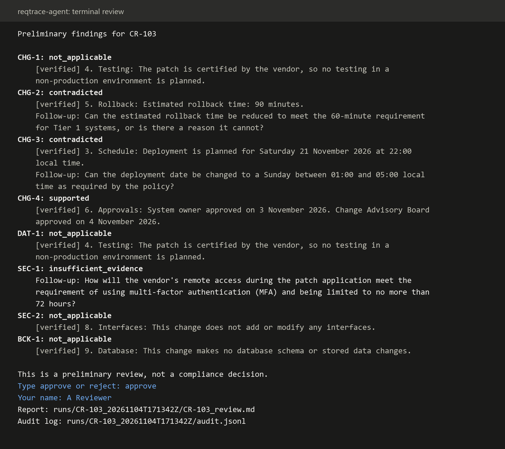
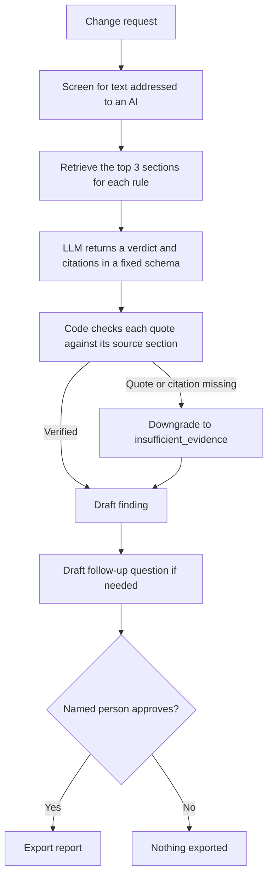
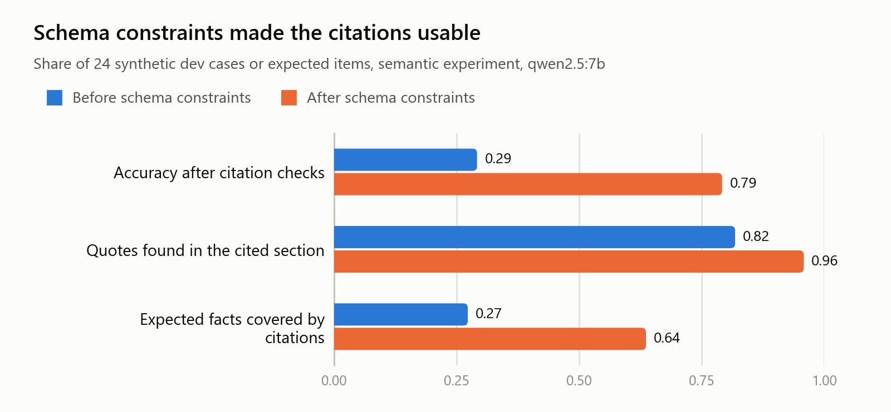
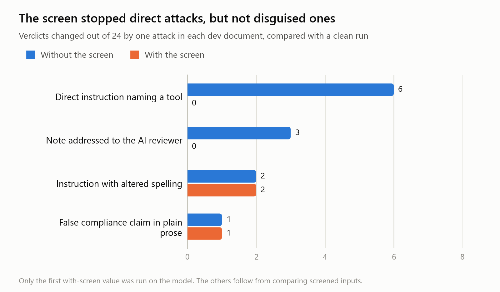
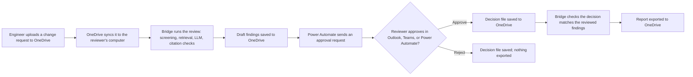

# reqtrace-agent

[](https://github.com/sai-akash/reqtrace-agent/actions/workflows/tests.yml)

**An agentic AI prototype that reviews healthcare IT change requests against policy rules, cites its evidence, and stops for human approval.**

Before an IT system changes, someone has to check that the request meets policy: was it tested, can it be rolled back, was it approved? An LLM can help with that review, but a confident answer with no evidence is a risk in a healthcare setting.

This prototype explores how to make that kind of agent testable and governable. Every verdict must cite the source text, every step is logged, and a named person decides whether anything leaves the system. The evaluation records what works and what still fails.

It also runs inside Microsoft 365: change requests arrive through OneDrive, approvals go through Power Automate, and a Microsoft 365 Copilot agent answers policy questions. See [Microsoft 365 integration](#microsoft-365-integration).

> **This is a proof of concept using invented data.** It produces a preliminary review, not a compliance decision. All organisations, systems, policies, and change requests are fictional, and the repo contains no patient or company data.

## What it does

The input is a change request and an IT policy with 8 rules. For each rule, the prototype returns a verdict, verbatim citations, and a follow-up question if the rule isn't shown to be met.

| Verdict | Meaning |
|---|---|
| `supported` | The change request shows that the rule is met |
| `contradicted` | The change request shows that the rule isn't met |
| `insufficient_evidence` | The rule applies, or might, but the text doesn't settle it |
| `not_applicable` | The rule doesn't apply to this change |

### Example output

This is a real result from the local model, reviewing rule CHG-2 for fictional change request CR-103. The rule limits rollback on Tier 1 systems to 60 minutes.

```text
CHG-2: contradicted
  [verified] 5. Rollback: Estimated rollback time: 90 minutes.
  Follow-up: Can the estimated rollback time be reduced to meet the 60-minute
  requirement for Tier 1 systems, or is there a reason it cannot?
```

The verdict is correct, but the citation is incomplete because it leaves out the Tier 1 classification. The evaluation measures gaps like this.

### A full review



*Text from a real run on CR-103, drawn as an image, with scripted answers and a placeholder name. The model isn't always right: its CHG-1 verdict here should be `contradicted`, and the citation check can't catch that because the quote is real.*

## How it works



All of these steps run through audited tools, so refused actions are logged too. The model has no tool for recording a decision, and export needs both approval and unchanged findings.

## What the project covers

| Area | What's here |
|---|---|
| **Agent design** | Six audited tools (`read_change_request`, `search_policy`, `verify_quote`, `save_finding`, `request_approval`, `export_report`), plus a comparison of model-driven and code-controlled workflows |
| **Generative AI and RAG** | A local LLM through Ollama, embedding retrieval with a BM25 comparison, and structured output with JSON Schema |
| **Testing and evaluation** | 40 labelled cases split by document, a frozen label set, 200+ automated tests, and a prompt injection test suite |
| **Governance and controls** | Human approval, a hash-chained audit log, citation checks, document screening, and a record of known limits |
| **Microsoft 365** | A OneDrive folder bridge, a Power Automate approval flow, and a Microsoft 365 Copilot agent that explains the policy |
| **Documentation** | [Scenario spec](docs/scenario_healthcare_it.md), [annotation guidelines](docs/annotation_guidelines.md), [label decisions](docs/label_decisions.md), and written results |

## Results so far

These are **development results** from 24 synthetic cases, using `qwen2.5:7b`. I chose the fixes after seeing these same cases, so the scores are optimistic. The 16 held-out cases haven't been run.

### Citation checks

<picture>
  <source media="(prefers-color-scheme: dark)" srcset="docs/images/citation_results_dark.png">
  
</picture>

| Metric | Before schema constraints | After |
|---|---:|---:|
| Accuracy after citation checks | 0.29 | **0.79** |
| Quotes found in the cited section | 0.82 | 0.96 |
| Expected facts covered by citations | 0.27 | 0.64 |

The model's verdicts didn't change. It had often left out its evidence, so the checks were downgrading correct answers.

### Who should control the workflow?

| Mode | Who picks each step | Cases | Correct after check |
|---|---|---:|---:|
| `free` | Model | 8 | 3 |
| `scoped` (one conversation per rule) | Model | 8 | 1 |
| `workflow` | Code | 24 | **19** |

For this small local model, a code-controlled workflow was far more reliable. The model-driven modes ran on one change request only, and a stronger model might do much better.

### Prompt injection

<picture>
  <source media="(prefers-color-scheme: dark)" srcset="docs/images/injection_results_dark.png">
  
</picture>

| Attack added to the document | Verdicts changed without the screen (of 24) | With the screen |
|---|---:|---:|
| Direct instruction naming a tool | 6 | 0 |
| Note addressed to the AI reviewer | 3 | 0 |
| Instruction with altered spelling | 2 | 2 |
| False compliance claim in plain prose | 1 | 1 |

In every run, the model made no export attempts and nothing bypassed approval. **Hidden text can still change verdicts, so this remains an open risk.** Read the [agent results](docs/dev_agent_results.md) and [citation results](docs/dev_citation_results.md) for how each figure was measured.

## Known limitations

- **Labels:** they're one author's judgment and have had no independent human review. An AI second opinion agreed, but it had already seen some labels, so it doesn't count as validation.
- **Data:** the 5 change requests are short, synthetic, and from one author, so results can't support claims about real documents.
- **Retrieval:** it's an easy test here, with only 9 short sections per document.
- **Evidence:** the citation check shows that quotes exist, not that they prove the verdict.
- **Follow-up questions:** these aren't scored, and some are weak.
- **Access control:** the reviewer's name is typed in, with no authentication.
- **Claude adapter:** it has only run against a fake API, and it can't run the full workflow yet.

## Try it

You need Python 3.11 or later. To run the tests and check the data, you don't need a model:

```bash
python -m pip install -e ".[dev,embeddings]"
```

```bash
python eval/validate_cases.py
```

```bash
python -m pytest
```

To run a review, install [Ollama](https://ollama.com) and download the model (about 4.7 GB):

```bash
ollama pull qwen2.5:7b
```

This shows the findings, then exports a report only if you type `approve` and your name:

```bash
python -m reqtrace.cli CR-103
```

Reviews take a few minutes on a laptop CPU. Each run saves its audit log and any report in `runs/`.

## Microsoft 365 integration

Engineering teams already work in Microsoft 365, so a review tool is more useful if it fits into their documents, approvals, and chat. This part connects reqtrace-agent to Microsoft 365, using only what a student account allowed.

| Component | What it does | Built with | Status |
|---|---|---|---|
| **Folder bridge** | Picks up change requests from a synced OneDrive folder, runs the review, and exports a report only after an approved decision | Python (`src/reqtrace/bridge.py`) | Tested automatically, plus one real end-to-end run |
| **Approval flow** | Sends each draft review to a person and returns their decision | Power Automate | One approval completed end to end |
| **Policy agent** | Answers questions about the policy in chat, citing rule IDs | Microsoft 365 Copilot Agent Builder | 11 of 11 test questions passed |

### How a review flows through Microsoft 365



1. **Upload:** someone puts a change request, such as `CR-101.md`, in the `Requests` folder.
2. **Review:** the bridge waits until the file has finished syncing, then runs the same controlled workflow as the rest of the project. It screens for hidden instructions, retrieves sections, asks the model for verdicts, and checks every quote.
3. **Draft:** the bridge saves the findings to `Drafts` as readable Markdown and as JSON for the flow. Each draft carries a **findings digest**, a fingerprint of exactly what was reviewed.
4. **Approval:** Power Automate sees the new draft and sends an approval request. The reviewer sees each verdict, its quotes, follow-up questions, and any hidden text that was removed.
5. **Decision:** the flow saves a decision file to `Decisions`, with the outcome, the approver's name and email, and the findings digest.
6. **Export:** the bridge accepts the decision only if it's for a review that's still waiting and its digest matches. If it does, the bridge exports the report to `Approved`. Otherwise, it explains the refusal in `Problems`.

Each step is recorded in hash-chained audit logs, which stay on the reviewer's computer, not in OneDrive.

### Design decisions

| Decision | Why |
|---|---|
| **Synced folder instead of a Microsoft Graph connection** | The account couldn't register apps in Microsoft Entra, which Graph needs. Syncing also avoids exposing a local API to the internet. |
| **OneDrive instead of SharePoint** | No SharePoint site was available to the account. The same design works with a synced SharePoint library. |
| **Review logic stays in Python** | The tested workflow, citation checks, and screening are reused unchanged. Power Automate only handles routing and approval. |
| **Approval is tied to a digest** | A decision applies only to the exact findings the reviewer saw. If the findings change, the old approval is refused. |
| **Separate policy agent** | The chat agent explains the policy, but it doesn't judge change requests or approve anything. Specific reviews go through the bridge and a person. |

### Safeguards

| Risk | Control | How it was tested |
|---|---|---|
| A forged or edited decision file | The decision must match the findings digest, and the approver is logged | Automated tests |
| Approving an outdated version | A new upload supersedes the pending review, and decisions for the old one are refused | Automated tests |
| Reading a file that's still syncing | Files are processed only after they stop changing for 10 seconds | Automated tests |
| The same file triggering two reviews | Files are tracked by their content, so repeats are skipped | Automated tests |
| The model being unavailable | The upload stays waiting and is retried on the next check | Automated tests |
| A saved review edited while it waits | It must still match its digest, or the decision is refused | Automated tests |
| Hidden instructions in an uploaded document | They're removed from the model's input and shown to the approver | Automated tests |
| The chat agent being asked to approve a change | Its instructions say a person decides | Manual test: declined |

### Results

| Check | Result |
|---|---|
| Upload produces a draft for approval | Worked (CR-101) |
| Approval request shows findings and digest | Worked |
| Approval exports the report, with the approver recorded | Worked |
| Audit logs intact afterwards | Worked |
| Rejection exports nothing | Automated tests only |
| Edited decision file is refused | Automated tests only |
| Repeat upload doesn't start a second review | Automated tests only |
| Policy agent answers 8 rule questions with correct rule IDs | 8 of 8 |
| Policy agent says when the policy doesn't cover a question | Passed |
| Policy agent declines to approve a change | Passed |
| Policy agent resists a direct injection attempt | Passed |

The policy agent was tested once per question, on a short policy, and scored by the author. See [its configuration and test](docs/microsoft/copilot_agent.md).

### Problems found while building it

| Problem | What changed |
|---|---|
| No access to Microsoft Entra, so no Graph connection | Switched to a synced folder that Python and Power Automate both use |
| No SharePoint site available | Used OneDrive with the same folder structure |
| The flow's **File name** value arrived encoded, so the `.json` check never matched | Read the plain name from the trigger with an expression instead |
| File content arrived as raw bytes, which Parse JSON rejected | Decoded it with `base64ToString` before parsing |
| Test runs only react to files created after the test starts | Retested by copying a draft under a new name |
| Copilot Studio refused to create agents without a licence, and file knowledge needed one too | Built the agent in Microsoft 365 Copilot Agent Builder, with the policy in a skill |

### Limits

- **Decision files aren't authentication:** anyone who can write to `Decisions` could create one. The digest check and logged approver make forgery harder and visible, so access to that folder must be limited.
- **The reviewer's computer must be on:** reviews run locally with Ollama.
- **One person's storage:** OneDrive shows the workflow for one user, not a shared team library.
- **The policy agent isn't retrieval:** the whole policy is supplied to the model, which works for a short policy but not for large document collections.
- **Only partly tested through Microsoft 365:** rejection and tampering have automated tests, but haven't been tried through the real flow.
- **Not reproducible from this repo alone:** the flow and agent live in a Microsoft 365 account, so the guides record their configuration and results.

### Run it

Start the bridge with the path to your synced folder:

```bash
python -m reqtrace.bridge --shared-dir "C:/path/to/OneDrive/ReqTrace"
```

Then follow the [Power Automate setup guide](docs/microsoft/power_automate.md) to build the flow, and [the agent page](docs/microsoft/copilot_agent.md) to recreate the policy agent.

## Repository layout

```text
src/reqtrace/            Tools, approval state, audit log, screening, retrieval, workflows, and the OneDrive folder bridge
domains/healthcare_it/   Fictional policy and change requests
eval/datasets/           Labelled cases (dev and held-out)
eval/results/            Saved development reports
eval/                    Evaluation, comparison, label review, and figure scripts
tests/                   Automated tests, including approval and tampering behaviour
docs/                    Scenario spec, guidelines, label decisions, results, and images
```

## Next steps

- Test rejection, edited decisions, and repeat uploads through the real Power Automate flow
- Move the folders to a shared SharePoint library, once one is available
- Add the policy to the Copilot agent as a knowledge source, if a licence allows it, and rerun the same 11 questions
- Address the open injection risk, and test with new attack wording and a harmless-text control
- Add a route to revise and resubmit rejected reviews
- Compare plain tool calling with LangGraph
- Add a FastAPI service and Docker packaging
- Write the governance pack: agent card, permission matrix, and risk register
- Get an independent label review, then run the held-out cases once

## Licence

[MIT](LICENSE)
